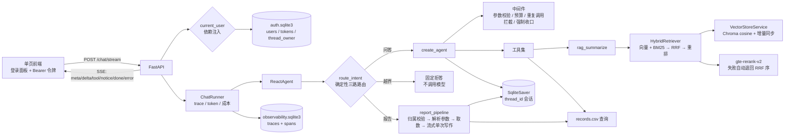

# 设计文档 · 扫地机器人客服 Agent

> 一句话：把一个「能跑通的 RAG demo」升级成**可评测、可恢复、可审计**的客服 Agent。
>
> 状态说明：本文区分 **已实施** 与 **计划中**，不把计划写成既成事实。

## 1. 定位与边界

| 项 | 内容 |
|---|---|
| 用户 | 扫地/扫拖机器人用户，询问选购、使用、维护、故障排查与个人使用报告 |
| 形态 | 对话式客服 Agent：FastAPI + SSE 为主入口，Streamlit 保留为本地调试入口 |
| 能力边界 | 只回答知识库覆盖的问题；超出范围应拒答或转人工，不编造 |
| 非目标 | 不做通用聊天助手、不做电商交易闭环、不做多租户 SaaS |

## 2. 现状架构（已实施）



关键点：

- **服务层**：`server/app.py` 只负责 HTTP；`ChatRunner` 把 Agent 事件包装成带 trace、token、成本与 `done` 统计的 SSE 流；前端是单文件 HTML，用 `fetch` + `ReadableStream` 解析。
- **身份层**：`server/auth.py` 管账号、令牌与会话归属，以 FastAPI 依赖 `current_user` 的形式挂在业务接口上；`thread_owner` 首次写入即认领，`/sessions` 用 `owner_filter` 在截断 limit 之前先过滤，报告链路用登录绑定的业务用户 ID 拦越权。
- **Agent 内核**：LangChain 1.x `create_agent` + 五个中间件（工具监控/护栏、日志、强制收口、报告提示词兜底切换、历史压缩）。中间件顺序是有意义的：`compress_history` 必须排在 `report_prompt_switch` 之后，因为后者是 `dynamic_prompt`、会整体替换 `system_message`。
- **RAG**：Chroma（cosine）持久化 + md5/切分签名增量同步；空库自愈；按 QA 结构切分（前言 / Q-A 对 / 【块】 / 编号条目），145 chunks，chunk 带 `section`/`unit`/`mode` 元数据；检索是「向量 + BM25 双路召回 → RRF 融合 → gte-rerank-v2 重排 → min_score 无证据兜底」。
- **会话**：`SqliteSaver` + `thread_id`，刷新或重启后可恢复；超过 16 条消息后由 `HistoryCompressor` 把较早轮次折成要点清单并进 system 消息，checkpoint 原文与界面历史保持完整。报告/拒答子流程用 `update_state` 写回同一 thread。
- **报告线**：`is_report_query` 判断意图后走确定性 `report_pipeline`——解析/补齐 `user_id`、`month`，直接 `fetch_external_data`，把 CSV 记录注入报告提示词，调用一次 `temperature=0` 模型写作；模型不参与工具选择。路由未命中的报告请求才回退 ReAct，`fetch_external_data` 成功仍会兜底切换报告提示词。`fill_context_for_report` 已删除。
- **越界线**：`scope_router` 先判报告、再判越界、最后问答；越界请求直接返回固定话术，不调用模型。
- **护栏**：单轮最多 6 次工具调用；相同成功调用只执行一次；失败允许换参数重试一次；参数不合规直接返回 `ToolMessage(status="error")`；连续拦截 2 次注入一次收口提示。
- **可观测**：每次请求一条 trace，路由/工具各一条 span；token 从供应商用量读取，缺数据不估算成本。

## 3. 检索管线（M2 已实施）

```mermaid
flowchart LR
    Q[用户问题] --> VS[向量召回<br/>cosine Top-20]
    Q --> BM[BM25 召回<br/>单字+双字 Top-20]
    VS --> RRF[RRF 融合<br/>1/(60+rank)]
    BM --> RRF
    RRF --> RR[gte-rerank-v2<br/>对融合后 20 条逐条打分]
    RR --> TH{最高分 ≥ min_score?}
    TH -->|否| NE[无证据兜底<br/>固定回答，不调模型]
    TH -->|是| TOPK[Top-3 进提示词]
    TOPK --> AN[生成回答]
```

四个阶段各自的职责与实测收益（55 easy + 20 hard，检索指标为 Span Recall@k）：

| 阶段 | 做了什么 | easy span@1 / @3 | hard span@1 / @3 |
|---|---|---|---|
| 起点 | 200 字定长切分 + L2 + 纯向量 Top-3 | 65.45% / 94.55% | 55.00% / 80.00% |
| ① QA 切分 | 按问答对/块/条目切，145 chunks，cosine | 67.27% / 87.27% | 50.00% / 85.00% |
| ② 混合召回 | 加 BM25 一路，RRF 融合 | 69.09% / 81.82% | 65.00% / 85.00% |
| ③ 重排 | 融合后 20 条交给交叉编码器 | **96.36% / 98.18%** | **80.00% / 100.00%** |
| ④ 兜底 | min_score=0.16，无证据不调模型 | @5/@8 均 100% | @5/@8 均 100% |

结论：**只换切分几乎没用（①甚至让 easy @3 掉了 7 个点），真正的收益来自重排**。①②把答案塞进候选池（easy 的 Top-8 未命中 1 → 0、hard 的 source@5 从 90% 到 100%），③负责把它排到前面——②之后 easy 有 10 题的 gold 落在第 4~7 名，重排后 9 题进了前三，只剩 `qa-023` 仍在第 4。注意 easy span@1 其实是逐阶段上升的（36 → 37 → 38 → 53 题），①②掉的是 @2/@3 那一批，说明切分改善的是块的质量、重排改善的是块的排序（详见 `docs/pitfalls.md` P16）。代价是检索延迟 P50：easy 126ms → 265ms、hard 157ms → 263ms，多出来的基本全是重排的一次同步调用。

## 4. 设计决策与取舍

| # | 决策 | 备选方案 | 为什么选它 | 代价 / 风险 | 状态 |
|---|---|---|---|---|---|
| 1 | **评测集先行**：先定 80–100 题与指标，再做优化 | 先堆功能，最后补评测 | 没有基线就无法归因；面试追问 L4 需要可复现数字 | 前期看不到「功能变多」的成就感 | **已实施**：easy 80 题 + hard 25 题、检索/回答基线、pass^3（2026-11-07） |
| 2 | **检索与生成拆开**：`retrieve` / `build_context` / `answer` 三个方法 | 保留 `rag_summarize` 一条龙 | 召回与生成可分别评测；换重排/换模型不影响另一半 | 多一层调用约定，调用方要自己串 | **已实施** |
| 3 | **按 QA 结构切分**，gold 标到 `source + 小节/题号` | 按固定字符数硬切；gold 标 chunk id | 问答对不能被切断；chunk id 会随切分策略变化而失效 | 需要针对数据写切分规则与校验 | **已实施**：`rag/chunking.py` 状态机切出前言 / Q-A 对 / 【块】 / 编号条目，66 → 145 chunks，逐行覆盖校验无丢行；`split_sig` 写进元数据，切分参数一变自动重切，chunk ID 也带指纹避免新旧互相覆盖。单独看指标几乎没提升（easy @3 反而 -7pt），它的价值是把答案切成可命中的最小单元，给后面的重排铺路 |
| 4 | **BM25 + 向量混合召回，RRF 融合** | 纯向量 Top-k；分数加权融合 | 型号、错误码等关键词靠 BM25，语义问题靠向量；RRF 不需调分数尺度 | 多一路索引与延迟；需要真实 BM25 实现，不能拿向量库冒充 | **已实施**：`rag/bm25.py` 手写倒排 + BM25（k1=1.5/b=0.75），中文用「单字 + 相邻双字」近似分词，高频字靠 IDF 自动降权，不引 jieba；`mode: vector` 时 BM25 路为空、融合结果等于向量原序，两种模式共用一条代码路径便于 A/B。hard span@1 50% → 65%、source@5 90% → 100% |
| 5 | **交叉编码器重排**（Top-20 → Top-3） | 不重排；用 LLM 重排 | 重排通常比换 embedding 性价比高；LLM 重排贵且慢 | 增加 100–300ms；模型需可离线/可替换 | **已实施**：DashScope `gte-rerank-v2`，对融合后的 20 条逐条打分；状态码非 200 / 异常 / 空结果一律退回 RRF 顺序并记日志。easy span@1 69.09% → 96.36%，hard span@3 85% → 100%，检索 P50 +119ms（easy）。分数还兼作「无证据」判据：`min_score=0.16` 由 `eval/calibrate_min_score.py` 在 105 题上标定（answerable 最低 0.1673 / in-scope negative 最高 0.1578），命中不足时直接返回固定回答，不调模型 |
| 6 | **显式路由 + 确定性报告子流程**，不靠模型「自觉」 | 一个 ReAct 循环里塞所有工具 | 报告与问答的工具面、提示词、失败处理不同；显式路由可测 | 规则路由需要维护覆盖率和兜底分支 | **已实施**：`is_report_query` → `report_pipeline`（解析参数 → 固定取数 → 单次写作）；路由未命中回退 ReAct。工具序列由代码保证，`fill_context_for_report` 已删除 |
| 7 | **SQLite checkpointer 起步** | 直接上 Postgres/Redis | 单机 demo 足够；接口一致，后续可替换 | 多实例不可用；需限制历史长度 | **已实施**（历史长度由决策 16 的压缩控制） |
| 8 | **SSE + 统一事件契约**（`meta/delta/tool/notice/done/error`） | WebSocket；前端轮询 | 单向流式足够；HTTP 基础设施简单；事件可断言、可回放 | 断线重连与取消要自己处理 | **已实施**：FastAPI `StreamingResponse`；首 token 与端到端延迟均落账；取消时 trace 记 `cancelled` |
| 9 | **薄前端**：单页静态 HTML/JS | React SPA、低代码平台 | 简历重点是 Agent/RAG 深度，不是前端工程量 | 页面表现力有限 | **已实施**：单文件 `server/static/index.html`，支持 SSE、停止生成、历史会话切换、近 7 天用量；回答区只保留正文 |
| 10 | **Token 账本**：usage 回调 → 队列 → 落表 → `/usage` | 只在日志里打印 | 成本是可被追问的硬指标；也是限流与预算的前提 | 需要模型返回 usage；流式下要确认口径 | **已实施**：供应商 `token_usage` 按 `request_id` 去重；缺用量不估算；按配置单价算成本 |
| 11 | **工具护栏前置在中间件**，不写进提示词 | 靠系统提示词要求模型少调工具 | 参数校验、预算、重复调用是硬约束，提示词无法保证 | 规则过严会误伤正常调用 | **已实施**：6 次预算、重复成功拦截、失败重试一次、连续拦截注入收口提示 |
| 12 | **越界请求确定性拒答** | 让模型自行判断是否越界 | 明确的服务边界不该消耗 token，也不该随模型波动 | 规则是启发式，复杂边界仍靠模型 | **已实施**：`scope_router` 先判报告、再判越界；宁可漏判不误伤 |
| 13 | **会话列表直接读 checkpoint**，不另建 sessions 表 | 新建会话表并在写入时维护；从 trace 反推 | checkpoint 已是会话内容真源，避免两份状态；trace 只有 M5 之后的记录，会漏历史 | 依赖 `checkpoints` 表结构；自定义 thread_id 不展示 | **已实施**：只列 32 位 hex 的前端线程，标题取首条用户消息，按最后写入排序，时间从 UUIDv6 解析；删除时先清 trace 再删 `writes`/`checkpoints`，只接受同一类线程 ID，避免误删评测数据 |
| 14 | **演示级身份 + thread 归属表**，用 FastAPI 依赖而不是中间件 | 完整登录/角色/权限系统；JWT 无状态令牌；先不做鉴权 | 简历要的是「会话按账号隔离、越权能被拦住」这条可验证的链路，不是产品级账号体系；依赖注入只作用于声明了它的接口，`/health`、`/auth/bootstrap` 与静态页天然公开，不用维护白名单 | 账号写死在配置里；令牌存 SQLite，每次请求一次查库；无刷新令牌与角色 | **已实施**：`server/auth.py` 用 PBKDF2-SHA256（20 万次迭代、16 字节盐、`hmac.compare_digest`）存密码，`secrets.token_urlsafe(32)` 发令牌并带过期时间；`thread_owner` 表首次写入即认领，别人的线程一律 403；不带 `thread_id` 时服务端发 `uuid4().hex`，不再共用 `"default"`（共用会让第一个用户把 default 占下来、其他人全部 403）；启动时把归属表里没有行的旧会话一次性归到 `legacy_owner`，否则开启鉴权后侧栏会变空；`enabled: false` 是评测脚本 / CLI / Streamlit 的逃生门 |
| 15 | **报告的越权校验放在取数之前**，用登录绑定的业务用户 ID | 只在提示词里要求模型别查别人；取数后再判断 | 隐私边界不能靠模型自觉；判断放在最前面才能做到「零取数、零 token」 | 需要在报告链路里多传一个 `owner_user_id` 参数 | **已实施**：`check_report_owner` 返回拒答文本时直接短路，`tool_calls=[]`、`no_model_call=True`，账本记 `usage_source="none"` 而不是 `"missing"`。参数解析顺序同时改成「显式入参 > 问题里抽的 > 登录绑定 ID > mock 工具」——登录绑定排在 mock 之前是必需的，否则「我的报告」会被 mock 抽到的随机用户号撞上归属校验，变成拒绝自己的查询（实跑发现的 bug，见 `docs/pitfalls.md` P17） |

| 16 | **历史压缩只改本次请求的视图**（`wrap_model_call` + `ModelRequest.override`），摘要并进 system 消息 | 官方 `SummarizationMiddleware`（`before_model` + `RemoveMessage`）；截断只留最近 N 条；摘要塞成一条 `HumanMessage` | `RemoveMessage` 会真的改写 state，早期对话就从界面和 checkpoint 里消失了，用户翻不回去；截断是硬丢事实；塞 `HumanMessage` 会让模型把摘要的排版当成回答模板 | 每轮多一次摘要调用（卡在首字延迟前面）；摘要本身可能编造，需要额外校验 | **已实施**：`agent/history_compressor.py`。触发 16 条 / 保留 8 条，边界不越过最后一条真实用户消息（当前轮不折）、不拆工具组；摘要按 thread 指纹缓存，折叠区变长时**从原文重写**而不是「旧摘要 + 新增」增量合并；出来后过一道 `find_unsourced_identifiers` 编造校验，摘要里出现对话稿中没有的型号/错误码/ID/日期就整轮放弃压缩。实测 36 条消息时 payload 3072 → 1700 input tokens（**-44.7%**），扣掉摘要自身开销后每轮净省 ¥0.0027；11 轮后界面历史 22 条完整、摘要零泄漏 |

## 5. 明确不做

- **不做双 Token 鉴权、MySQL/Redis/Alembic、重型 React 前端**：这些是产品工程量，不是本项目的差异化。（身份这块后来按最小可用做了一版：单令牌 + SQLite 归属表，只为了把「会话按账号隔离、越权被拦」这条链路变成可验证的，不做刷新令牌、角色与注册。）
- **不做伪 BM25**：如果引入混合检索，就用真实关键词索引，并在文档里写清实现。（已兑现：`rag/bm25.py` 是自己写的倒排表 + BM25 打分，不是拿向量库相似度冒充。）
- **不为「看起来完整」保留死代码**：未接通的模块宁可删掉，也不留在仓库里当装饰。

## 6. 里程碑与验收

当前进度：**M1–M5 全部完成**（easy/hard 评测与 pass^k；QA 切分 + 混合召回 + 重排 + 无证据兜底；FastAPI + SSE + 前端；工具护栏与越界路由；trace/token 账本），报告确定性流程已提前落地。

| 阶段 | 内容 | 验收证据 |
|---|---|---|
| M1 | 评测集 + `run_eval.py` / `run_answer_eval.py` + 基线报告 | 题量、标注方式、Recall@k / 拒答正确率 / faithfulness 基线表；报告字段与延迟前后对比 |
| M2 | QA 切分 + 混合召回 + 重排 + 无证据兜底 | 同一评测集前后对比（见第 3 节与 `docs/testing.md` §5.13）：easy span@1 65.45% → 96.36%、hard span@3 80% → 100%，两边 Top-8 未命中 3 题 → 0 题；回答级 easy 完全正确 81.82% → 90.91%、hard 通过率 95% → 100%；延迟代价 easy 检索 P50 126ms → 261ms |
| M3 | FastAPI + SSE + 薄前端 | `uvicorn server.app:app` 可复现启动；13 个 API/事件流单测；实跑 QA/报告/越界三条链路与会话切换/删除 |
| M4 | 工具护栏 + 循环熔断 + 路由覆盖率 | 越界拒答、参数拦截、重复调用拦截、强制收口的单测与实跑；报告确定性流程已提前完成 |
| M5 | Trace + 成本 + 部署 | 每次请求一条 trace + spans；`/usage` 汇总；真实请求的 token、首 token、成本与延迟 |

## 7. 已知短板（当前）

1. ~~`stream_mode="values"` 会把工具消息/用户消息一起推给前端，且不是 token 级流式。~~ 已改 `stream_mode=["messages","updates"]`，只收 `model` 节点的增量文本；Streamlit 也改为 `write_stream`，不再逐字 sleep。
2. ~~向量库默认 L2 距离，文本检索未改 cosine。~~ 已改 cosine；距离空间只能在创建集合时指定，`VectorStoreService` 检测到不一致会重建集合并重新灌库。
3. ~~Top-3 纯向量召回，无阈值、无重排、无混合检索（M2）。~~ M2 已完成：QA 切分 + BM25/向量双路 + RRF + `gte-rerank-v2` 重排 + `min_score` 无证据兜底，见第 3 节。
4. 用户、月份、位置工具仍是随机 mock。
5. ~~会话历史全量回灌，无截断/摘要。~~ 已实施压缩（决策 16）：超过 16 条消息时把较早轮次折成要点清单并进 system 消息，checkpoint 与界面历史不动。剩下的短板是**每轮都从原文重写摘要**，摘要调用的输入随会话长度线性增长（36 条消息时约 1485 tokens / 0.8–3.4s），会话很长时这笔开销会重新变大；改成「只摘新增的那几轮再拼接」可以把每轮成本压成常数，但要额外处理要点条数上限与淘汰顺序，本轮没做。
6. 回答级评测已有 easy 单次基线、hard split 与 hard pass^3；尚缺 easy 全量 pass^k。
7. ~~模块导入即构造模型与 RAG 服务，启动失败不易被页面捕获。~~ RAG 改为惰性单例；FastAPI 在 lifespan 中构造 Agent，失败时 `/health` 返回 503 与原因，导入 `server.app` 不触发知识库加载。
8. ~~报告流程仍可能漏调 `fill_context_for_report`~~：已改为确定性报告子流程，正常报告不再经过 ReAct，`fill` 工具已删除；仅规则路由未命中的请求走 ReAct 兜底（P7）。
9. 报告生成已由确定性流程固定为「取数 1 次 + 写作 1 次」，P50 从 12.5 秒降到 **7.25 秒**；SSE 后首 token 约 0.4–0.8 秒，但完整回答仍需 6–8 秒，要稳定压到 5 秒内需要更快的报告模型或更短模板。
10. 护栏与越界规则是启发式：复杂越界请求仍可能落到模型；`hard-neg-002/004` 这类“能力边界”问题没有被确定性拦截。
11. trace 账本是单机 SQLite，多实例部署需要换 Postgres 或接 OpenTelemetry；`answer` 只保留前 8000 字。
12. ~~前端没有鉴权、限流与多用户隔离；`thread_id` 由客户端生成，适合本地演示，不适合直接暴露公网。~~ 鉴权与会话隔离已实施（决策 14/15）：除 `/health`、`/auth/bootstrap`、`/auth/login` 与静态页外都要带 Bearer 令牌，会话按归属过滤，别人的线程 403，报告查别人的用户 ID 直接拒答。剩下的短板是**限流仍没有**，且身份是演示级的（账号写死在 `config/auth.yml`，无注册、无刷新令牌、无角色权限），公网部署前必须改密码或删库重建。
20. 观测接口只做了「要登录」，没做「按账号隔离」：任何登录用户调 `/traces`、`/trace/{id}`、`/usage` 看到的都是全量数据（实测 alice 登录后 `/usage` 仍显示 8 次请求、12,024 tokens，其中大部分是 demo 产生的）。trace 表里没有 `username` 列，要隔离得先补这一列再改查询，属于下一步而不是本轮范围。
21. `/chat/stream` 不校验 `thread_id` 的格式（只限制长度 ≤ 64）：传一个非 32 位 hex 的 ID 会照常写入 checkpoint，但 `is_session_thread` 会把它排除在会话列表外，`DELETE /sessions/{id}` 也返回 422，于是留下一条既看不见又删不掉的孤儿线程。归属表同理会多一行。验证脚本用截断的 ID 就造出过一条（已手工清理）。要堵这个口子得在入口按同一套规则校验 thread_id，代价是不能再用 `smoke-qa-1` 这类可读 ID 走 HTTP。
13. easy negative 复跑 100% 来自确定性规则覆盖（15 题全部命中），不代表开放式边界已解决；hard negative 的严格 pass^3 仍只有 60%。
14. easy answerable 单次 55/55 通过，完全正确率从 81.82% 提到 **90.91%**（M2 后），仍有 5 题是 partial：多数是「标准答案要点没答全」，不是答错。hard 从 95% 通过率 / 75% 完全正确提到 100% / 95%。
15. `min_score=0.16` 的可分区间很窄：未被路由拦下的 negative 最高 0.1578，answerable 最低 0.1673，阈值只留了约 4% 余量。换语料、换重排模型都必须重跑 `eval/calibrate_min_score.py`。误判方向是安全的——误拒只会得到固定兜底话术，不会编造，但用户需要重问一次。
16. 重排是一次同步外部调用：检索 P50 easy 146ms → 265ms、hard 139ms → 263ms，多出的约 120ms 全在这一次调用上；DashScope 不可用时静默退回 RRF 顺序，功能不受影响但检索质量掉回 easy @3 81.82% / hard @3 85%。`stats["rerank"]` 取 `ok/fallback/disabled`，可据此判断当次是否真的重排了。
17. BM25 索引是进程内存里的倒排表，按语料指纹缓存（145 chunks 建索引约 40ms），并在向量库条数变化时自动重建；多实例部署时每实例各建一份，没有跨进程失效通知，灌库要走同一进程的 `ensure_knowledge_base()`。
18. QA 切分把 chunk 变小、变准，但跨小节的多要点问题（例如「养宠家庭选什么」要同时覆盖选购与保养）只能靠 Top-3 里的多条凑，没有做父文档/同小节扩展。副作用是上下文变窄后模型偶尔补一句资料里没有的话：`qa-017` 提到「电池老化」，faithfulness 只有 1/2（easy 完全有据 100% → 98.18%）。
19. `k=3` 与 `k=5` 在 hard 回答级上各差 1 题（grounded 95% → 100%，correct 95% → 90%）；20 题样本下每题就是 5 个百分点，属于噪声，因此没有据此调 k，仍取 3 以控制上下文长度与延迟。

> 这些短板会在 M1–M5 中逐项处理；`docs/pitfalls.md` 记录已经踩过的坑与修复状态。

## 8. 目录约定

```text
agent/        Agent 装配、路由、护栏、工具、中间件
server/       FastAPI 入口、SSE 运行器、单页前端
observability/ token 用量、成本估算、trace/span 存储
rag/          向量库、检索、生成
model/        模型工厂
utils/        配置、日志、文件、路径
config/       YAML 配置
prompts/      提示词
data/         知识库与 mock 业务数据（见 data/README.md）
eval/         评测集、评测脚本、结果
docs/         设计、踩坑、演示材料
tests/        纯函数、护栏、API 与事件流单测
```
