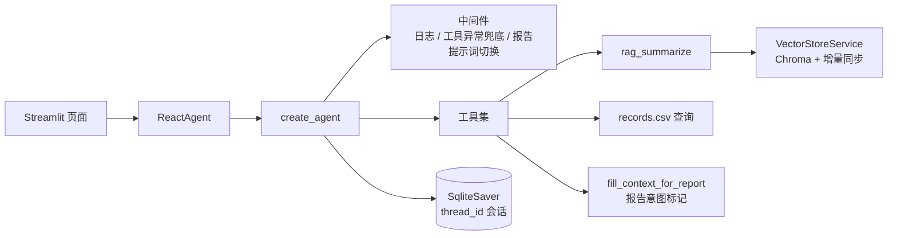
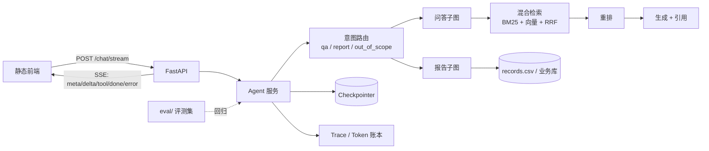

# 设计文档 · 扫地机器人客服 Agent

> 一句话：把一个「能跑通的 RAG demo」升级成**可评测、可恢复、可审计**的客服 Agent。
>
> 状态说明：本文区分 **已实施** 与 **计划中**，不把计划写成既成事实。

## 1. 定位与边界

| 项 | 内容 |
|---|---|
| 用户 | 扫地/扫拖机器人用户，询问选购、使用、维护、故障排查与个人使用报告 |
| 形态 | 对话式客服 Agent（Streamlit 现阶段 → FastAPI + SSE 计划中） |
| 能力边界 | 只回答知识库覆盖的问题；超出范围应拒答或转人工，不编造 |
| 非目标 | 不做通用聊天助手、不做电商交易闭环、不做多租户 SaaS |

## 2. 现状架构（已实施）



关键点：

- **Agent 内核**：LangChain 1.x `create_agent` + 三个中间件（`before_model`、`wrap_tool_call`、`dynamic_prompt`）。
- **RAG**：Chroma 持久化 + md5 元数据增量同步；空库自愈；chunk 200 / overlap 20。
- **会话**：`SqliteSaver` + `thread_id`，刷新或重启后可恢复；历史全量回灌（待压缩）。
- **报告线**：模型调用空壳工具 `fill_context_for_report`，中间件写 `runtime.context`，再切换报告提示词。

## 3. 目标架构（计划中）



升级主线只有一条：**先把「答得对不对」变成可测量，再谈换模型、加工具、做前端。**

## 4. 设计决策与取舍

| # | 决策 | 备选方案 | 为什么选它 | 代价 / 风险 | 状态 |
|---|---|---|---|---|---|
| 1 | **评测集先行**：先定 80–100 题与指标，再做优化 | 先堆功能，最后补评测 | 没有基线就无法归因；面试追问 L4 需要可复现数字 | 前期看不到「功能变多」的成就感 | **部分完成**：80 题 + 检索基线；回答级评测待做 |
| 2 | **检索与生成拆开**：`retrieve` / `build_context` / `answer` 三个方法 | 保留 `rag_summarize` 一条龙 | 召回与生成可分别评测；换重排/换模型不影响另一半 | 多一层调用约定，调用方要自己串 | **已实施** |
| 3 | **按 QA 结构切分**，gold 标到 `source + 小节/题号` | 按固定字符数硬切；gold 标 chunk id | 问答对不能被切断；chunk id 会随切分策略变化而失效 | 需要针对数据写切分规则与校验 | 计划中 |
| 4 | **BM25 + 向量混合召回，RRF 融合** | 纯向量 Top-k；分数加权融合 | 型号、错误码等关键词靠 BM25，语义问题靠向量；RRF 不需调分数尺度 | 多一路索引与延迟；需要真实 BM25 实现，不能拿向量库冒充 | 计划中 |
| 5 | **交叉编码器重排**（Top-20 → Top-5） | 不重排；用 LLM 重排 | 重排通常比换 embedding 性价比高；LLM 重排贵且慢 | 增加 100–300ms；模型需可离线/可替换 | 计划中 |
| 6 | **显式路由 + 报告子图**，不靠模型「自觉」 | 一个 ReAct 循环里塞所有工具 | 报告与问答的工具面、提示词、失败处理不同；显式路由可测 | 需要维护路由准确率与兜底分支 | 计划中 |
| 7 | **SQLite checkpointer 起步** | 直接上 Postgres/Redis | 单机 demo 足够；接口一致，后续可替换 | 多实例不可用；需限制历史长度 | **已实施**（压缩待做） |
| 8 | **SSE + 统一事件契约**（`meta/delta/tool/done/error`） | WebSocket；前端轮询 | 单向流式足够；HTTP 基础设施简单；事件可断言、可回放 | 断线重连与取消要自己处理 | 计划中 |
| 9 | **薄前端**：单页静态 HTML/JS | React SPA、低代码平台 | 简历重点是 Agent/RAG 深度，不是前端工程量 | 页面表现力有限 | 计划中 |
| 10 | **Token 账本**：usage 回调 → 队列 → 落表 → `/usage` | 只在日志里打印 | 成本是可被追问的硬指标；也是限流与预算的前提 | 需要模型返回 usage；流式下要确认口径 | 计划中 |

## 5. 明确不做

- **不做双 Token 鉴权、MySQL/Redis/Alembic、重型 React 前端**：这些是产品工程量，不是本项目的差异化。
- **不做伪 BM25**：如果引入混合检索，就用真实关键词索引，并在文档里写清实现。
- **不为「看起来完整」保留死代码**：未接通的模块宁可删掉，也不留在仓库里当装饰。

## 6. 里程碑与验收

当前进度：M1 的**检索部分**已完成（80 题 + 55 道基线）；回答级评测、M2–M5 未开始。

| 阶段 | 内容 | 验收证据 |
|---|---|---|
| M1 | 评测集 + `run_eval.py` + 基线报告 | 题量、标注方式、Recall@k / 拒答正确率 / faithfulness 基线表 |
| M2 | QA 切分 + 混合召回 + 重排 | 同一评测集前后对比；延迟代价一并报 |
| M3 | FastAPI + SSE + 薄前端 | 可复现的启动命令；事件序列截图/录屏 |
| M4 | 路由 + 报告子图 + 工具护栏 | 越界拒答、工具失败降级、循环熔断的演示 |
| M5 | Trace + 成本 + 部署 | 一次真实请求的 span 树；单次成本与优化前后对比 |

## 7. 已知短板（当前）

1. `stream_mode="values"` 会把工具消息/用户消息一起推给前端，且不是 token 级流式。
2. 向量库默认 L2 距离，文本检索未改 cosine。
3. Top-3 纯向量召回，无阈值、无重排、无混合检索。
4. 用户、月份、位置工具仍是随机 mock。
5. 会话历史全量回灌，无截断/摘要。
6. 已有检索评测，仍缺回答级评测（拒答 / faithfulness）、trace、token 与成本账本。
7. 模块导入即构造模型与 RAG 服务，启动失败不易被页面捕获。

> 这些短板会在 M1–M5 中逐项处理；`docs/pitfalls.md` 记录已经踩过的坑与修复状态。

## 8. 目录约定

```text
agent/        Agent 装配、工具、中间件
rag/          向量库、检索、生成
model/        模型工厂
utils/        配置、日志、文件、路径
config/       YAML 配置
prompts/      提示词
data/         知识库与 mock 业务数据（见 data/README.md）
eval/         评测集、评测脚本、结果
docs/         设计、踩坑、演示材料
tests/        单元测试（计划中）
```
