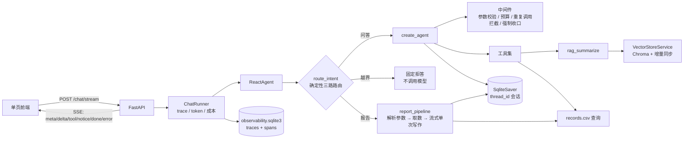
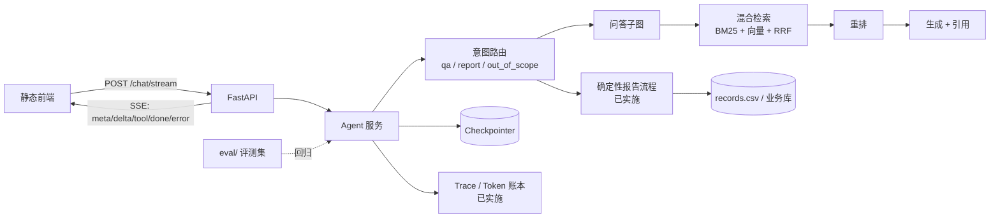

# 设计文档 · 扫地机器人客服 Agent

> 一句话：把一个「能跑通的 RAG demo」升级成**可评测、可恢复、可审计**的客服 Agent。
>
> 状态说明：本文区分 **已实施** 与 **计划中**，不把计划写成既成事实。

## 1. 定位与边界

| 项 | 内容 |
|---|---|
| 用户 | 扫地/扫拖机器人用户，询问选购、使用、维护、故障排查与个人使用报告 |
| 形态 | 对话式客服 Agent：FastAPI + SSE 为主入口，Streamlit 保留为本地调试入口 |
| 能力边界 | 只回答知识库覆盖的问题；超出范围应拒答或转人工，不编造 |
| 非目标 | 不做通用聊天助手、不做电商交易闭环、不做多租户 SaaS |

## 2. 现状架构（已实施）



关键点：

- **服务层**：`server/app.py` 只负责 HTTP；`ChatRunner` 把 Agent 事件包装成带 trace、token、成本与 `done` 统计的 SSE 流；前端是单文件 HTML，用 `fetch` + `ReadableStream` 解析。
- **Agent 内核**：LangChain 1.x `create_agent` + 四个中间件（工具监控/护栏、日志、强制收口、报告提示词兜底切换）。
- **RAG**：Chroma 持久化 + md5 元数据增量同步；空库自愈；chunk 200 / overlap 20。
- **会话**：`SqliteSaver` + `thread_id`，刷新或重启后可恢复；历史全量回灌（待压缩）。报告/拒答子流程用 `update_state` 写回同一 thread。
- **报告线**：`is_report_query` 判断意图后走确定性 `report_pipeline`——解析/补齐 `user_id`、`month`，直接 `fetch_external_data`，把 CSV 记录注入报告提示词，调用一次 `temperature=0` 模型写作；模型不参与工具选择。路由未命中的报告请求才回退 ReAct，`fetch_external_data` 成功仍会兜底切换报告提示词。`fill_context_for_report` 已删除。
- **越界线**：`scope_router` 先判报告、再判越界、最后问答；越界请求直接返回固定话术，不调用模型。
- **护栏**：单轮最多 6 次工具调用；相同成功调用只执行一次；失败允许换参数重试一次；参数不合规直接返回 `ToolMessage(status="error")`；连续拦截 2 次注入一次收口提示。
- **可观测**：每次请求一条 trace，路由/工具各一条 span；token 从供应商用量读取，缺数据不估算成本。

## 3. 目标架构（仅剩 M2）



升级主线只有一条：**先把「答得对不对」变成可测量，再谈换模型、加工具、做前端。** M3/M4/M5 已完成，M2 的检索优化仍待做。

## 4. 设计决策与取舍

| # | 决策 | 备选方案 | 为什么选它 | 代价 / 风险 | 状态 |
|---|---|---|---|---|---|
| 1 | **评测集先行**：先定 80–100 题与指标，再做优化 | 先堆功能，最后补评测 | 没有基线就无法归因；面试追问 L4 需要可复现数字 | 前期看不到「功能变多」的成就感 | **已实施**：easy 80 题 + hard 25 题、检索/回答基线、pass^3（2026-11-07） |
| 2 | **检索与生成拆开**：`retrieve` / `build_context` / `answer` 三个方法 | 保留 `rag_summarize` 一条龙 | 召回与生成可分别评测；换重排/换模型不影响另一半 | 多一层调用约定，调用方要自己串 | **已实施** |
| 3 | **按 QA 结构切分**，gold 标到 `source + 小节/题号` | 按固定字符数硬切；gold 标 chunk id | 问答对不能被切断；chunk id 会随切分策略变化而失效 | 需要针对数据写切分规则与校验 | 计划中 |
| 4 | **BM25 + 向量混合召回，RRF 融合** | 纯向量 Top-k；分数加权融合 | 型号、错误码等关键词靠 BM25，语义问题靠向量；RRF 不需调分数尺度 | 多一路索引与延迟；需要真实 BM25 实现，不能拿向量库冒充 | 计划中 |
| 5 | **交叉编码器重排**（Top-20 → Top-5） | 不重排；用 LLM 重排 | 重排通常比换 embedding 性价比高；LLM 重排贵且慢 | 增加 100–300ms；模型需可离线/可替换 | 计划中 |
| 6 | **显式路由 + 确定性报告子流程**，不靠模型「自觉」 | 一个 ReAct 循环里塞所有工具 | 报告与问答的工具面、提示词、失败处理不同；显式路由可测 | 规则路由需要维护覆盖率和兜底分支 | **已实施**：`is_report_query` → `report_pipeline`（解析参数 → 固定取数 → 单次写作）；路由未命中回退 ReAct。工具序列由代码保证，`fill_context_for_report` 已删除 |
| 7 | **SQLite checkpointer 起步** | 直接上 Postgres/Redis | 单机 demo 足够；接口一致，后续可替换 | 多实例不可用；需限制历史长度 | **已实施**（压缩待做） |
| 8 | **SSE + 统一事件契约**（`meta/delta/tool/notice/done/error`） | WebSocket；前端轮询 | 单向流式足够；HTTP 基础设施简单；事件可断言、可回放 | 断线重连与取消要自己处理 | **已实施**：FastAPI `StreamingResponse`；首 token 与端到端延迟均落账；取消时 trace 记 `cancelled` |
| 9 | **薄前端**：单页静态 HTML/JS | React SPA、低代码平台 | 简历重点是 Agent/RAG 深度，不是前端工程量 | 页面表现力有限 | **已实施**：单文件 `server/static/index.html`，支持 SSE、停止生成、历史会话切换、近 7 天用量；回答区只保留正文 |
| 10 | **Token 账本**：usage 回调 → 队列 → 落表 → `/usage` | 只在日志里打印 | 成本是可被追问的硬指标；也是限流与预算的前提 | 需要模型返回 usage；流式下要确认口径 | **已实施**：供应商 `token_usage` 按 `request_id` 去重；缺用量不估算；按配置单价算成本 |
| 11 | **工具护栏前置在中间件**，不写进提示词 | 靠系统提示词要求模型少调工具 | 参数校验、预算、重复调用是硬约束，提示词无法保证 | 规则过严会误伤正常调用 | **已实施**：6 次预算、重复成功拦截、失败重试一次、连续拦截注入收口提示 |
| 12 | **越界请求确定性拒答** | 让模型自行判断是否越界 | 明确的服务边界不该消耗 token，也不该随模型波动 | 规则是启发式，复杂边界仍靠模型 | **已实施**：`scope_router` 先判报告、再判越界；宁可漏判不误伤 |
| 13 | **会话列表直接读 checkpoint**，不另建 sessions 表 | 新建会话表并在写入时维护；从 trace 反推 | checkpoint 已是会话内容真源，避免两份状态；trace 只有 M5 之后的记录，会漏历史 | 依赖 `checkpoints` 表结构；自定义 thread_id 不展示 | **已实施**：只列 32 位 hex 的前端线程，标题取首条用户消息，按最后写入排序，时间从 UUIDv6 解析；删除时先清 trace 再删 `writes`/`checkpoints`，只接受同一类线程 ID，避免误删评测数据 |

## 5. 明确不做

- **不做双 Token 鉴权、MySQL/Redis/Alembic、重型 React 前端**：这些是产品工程量，不是本项目的差异化。
- **不做伪 BM25**：如果引入混合检索，就用真实关键词索引，并在文档里写清实现。
- **不为「看起来完整」保留死代码**：未接通的模块宁可删掉，也不留在仓库里当装饰。

## 6. 里程碑与验收

当前进度：**M1、M3、M4、M5 已完成**（easy/hard 评测与 pass^k；FastAPI + SSE + 前端；工具护栏与越界路由；trace/token 账本），报告确定性流程已提前落地；**M2 检索优化未开始**。

| 阶段 | 内容 | 验收证据 |
|---|---|---|
| M1 | 评测集 + `run_eval.py` / `run_answer_eval.py` + 基线报告 | 题量、标注方式、Recall@k / 拒答正确率 / faithfulness 基线表；报告字段与延迟前后对比 |
| M2 | QA 切分 + 混合召回 + 重排 | 同一评测集前后对比；延迟代价一并报（未开始） |
| M3 | FastAPI + SSE + 薄前端 | `uvicorn server.app:app` 可复现启动；13 个 API/事件流单测；实跑 QA/报告/越界三条链路与会话切换/删除 |
| M4 | 工具护栏 + 循环熔断 + 路由覆盖率 | 越界拒答、参数拦截、重复调用拦截、强制收口的单测与实跑；报告确定性流程已提前完成 |
| M5 | Trace + 成本 + 部署 | 每次请求一条 trace + spans；`/usage` 汇总；真实请求的 token、首 token、成本与延迟 |

## 7. 已知短板（当前）

1. ~~`stream_mode="values"` 会把工具消息/用户消息一起推给前端，且不是 token 级流式。~~ 已改 `stream_mode=["messages","updates"]`，只收 `model` 节点的增量文本；Streamlit 也改为 `write_stream`，不再逐字 sleep。
2. 向量库默认 L2 距离，文本检索未改 cosine。
3. Top-3 纯向量召回，无阈值、无重排、无混合检索（M2）。
4. 用户、月份、位置工具仍是随机 mock。
5. 会话历史全量回灌，无截断/摘要。
6. 回答级评测已有 easy 单次基线、hard split 与 hard pass^3；尚缺 easy 全量 pass^k。
7. ~~模块导入即构造模型与 RAG 服务，启动失败不易被页面捕获。~~ RAG 改为惰性单例；FastAPI 在 lifespan 中构造 Agent，失败时 `/health` 返回 503 与原因，导入 `server.app` 不触发知识库加载。
8. ~~报告流程仍可能漏调 `fill_context_for_report`~~：已改为确定性报告子流程，正常报告不再经过 ReAct，`fill` 工具已删除；仅规则路由未命中的请求走 ReAct 兜底（P7）。
9. 报告生成已由确定性流程固定为「取数 1 次 + 写作 1 次」，P50 从 12.5 秒降到 **7.25 秒**；SSE 后首 token 约 0.4–0.8 秒，但完整回答仍需 6–8 秒，要稳定压到 5 秒内需要更快的报告模型或更短模板。
10. 护栏与越界规则是启发式：复杂越界请求仍可能落到模型；`hard-neg-002/004` 这类“能力边界”问题没有被确定性拦截。
11. trace 账本是单机 SQLite，多实例部署需要换 Postgres 或接 OpenTelemetry；`answer` 只保留前 8000 字。
12. 前端没有鉴权、限流与多用户隔离；`thread_id` 由客户端生成，适合本地演示，不适合直接暴露公网。
13. easy negative 复跑 100% 来自确定性规则覆盖（15 题全部命中），不代表开放式边界已解决；hard negative 的严格 pass^3 仍只有 60%。
14. easy answerable 单次 55/55 通过，但完全正确率仍是 81.82%，`qa-042` 只是 partial 通过；片段级检索问题要等 M2。

> 这些短板会在 M1–M5 中逐项处理；`docs/pitfalls.md` 记录已经踩过的坑与修复状态。

## 8. 目录约定

```text
agent/        Agent 装配、路由、护栏、工具、中间件
server/       FastAPI 入口、SSE 运行器、单页前端
observability/ token 用量、成本估算、trace/span 存储
rag/          向量库、检索、生成
model/        模型工厂
utils/        配置、日志、文件、路径
config/       YAML 配置
prompts/      提示词
data/         知识库与 mock 业务数据（见 data/README.md）
eval/         评测集、评测脚本、结果
docs/         设计、踩坑、演示材料
tests/        纯函数、护栏、API 与事件流单测
```
